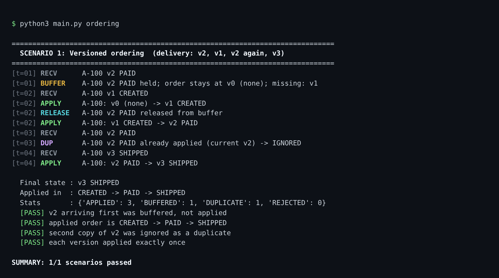
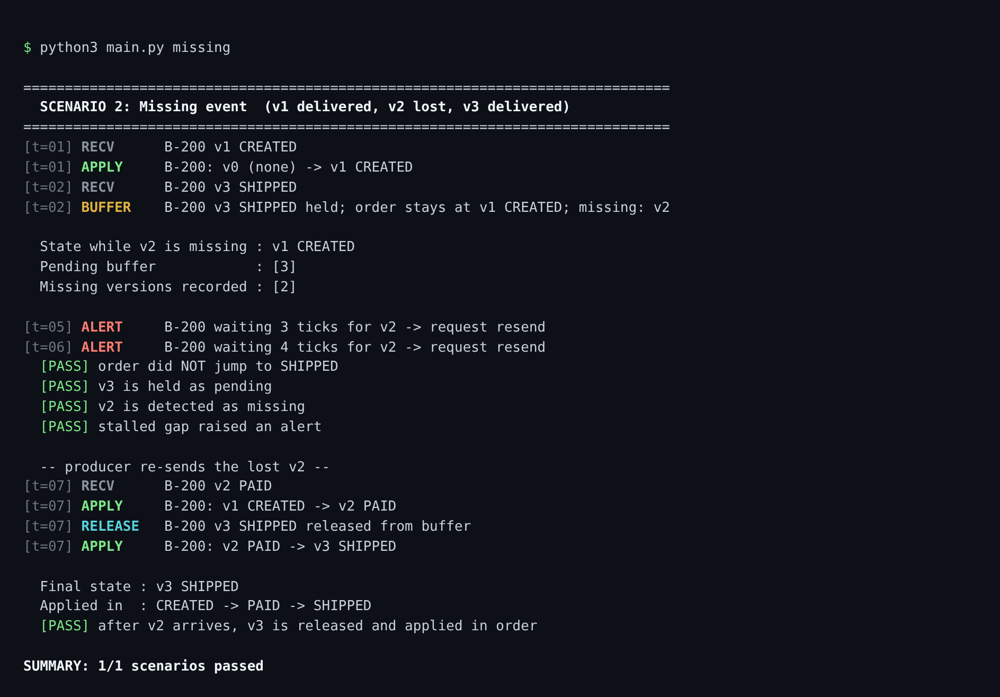
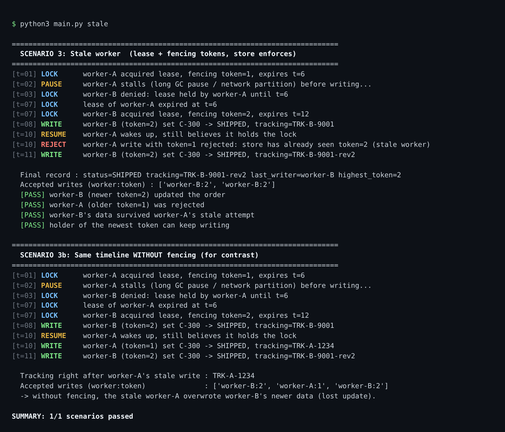
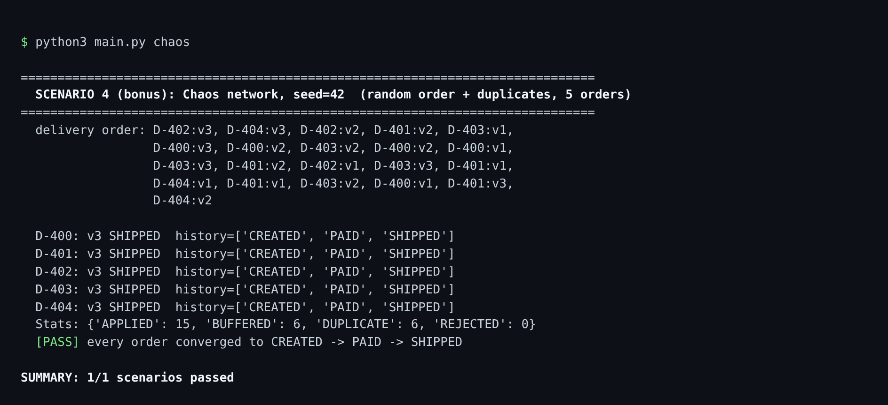

# Event Ordering, Delayed Messages & Stale Workers — Distributed Systems Lab

A small Python simulation of an order-processing service where each order moves
through versioned states:

```
CREATED (v1)  →  PAID (v2)  →  SHIPPED (v3)
```

Events can arrive **late, out of order, or more than once**, and two workers can
race to update the same order. The simulation shows how a consumer uses
**version numbers** to apply updates in the right order (and ignore duplicates),
and how a storage layer uses **fencing tokens** to reject a stale worker.

No third-party packages are needed — only the Python 3.10+ standard library.

---

## How to run

```bash
git clone https://github.com/Soumya-Atluri/event-ordering-lab.git
cd event-ordering-lab

python3 main.py              # run all scenarios (exit code 0 = all passed)

python3 main.py ordering     # 1. versioned ordering: v2, v1, v2 again
python3 main.py missing      # 2. missing event (v2 lost, v3 arrives)
python3 main.py stale        # 3. stale worker vs. fencing tokens
python3 main.py chaos        # 4. bonus: random delays + duplicates, 5 orders
python3 main.py chaos --seed 7   # try a different random delivery order

python3 -m unittest discover -s tests -t . -v   # 11 unit tests
```

Optional — regenerate the screenshots in `docs/screenshots/`:

```bash
pip install playwright && playwright install chromium
python3 scripts/render_screenshots.py
```

## Project layout

```
main.py                     CLI that runs the four scenarios and prints PASS/FAIL checks
order_sim/
  events.py                 OrderEvent(order_id, version, status) + lifecycle
  processor.py              OrderProcessor: in-order apply, pending buffer, dedup, gap alerts
  fencing.py                LockService (leases + fencing tokens), FencedOrderStore, Worker
  log.py                    tick-stamped logger
tests/                      unittest suite (ordering + fencing)
docs/sample-output.txt      full terminal output of `python3 main.py`
docs/test-output.txt        full output of the unit tests
docs/screenshots/*.png      terminal screenshots of each scenario
```

## Design

### Versioned ordering (`order_sim/processor.py`)

Each order keeps `version` (last applied), `status`, and a `pending` buffer.
For every incoming event:

| Condition | Action |
|---|---|
| `version == current + 1` | **Apply**, then drain the buffer (release any held `current+1`, `current+2`, …) |
| `version > current + 1` | **Buffer** it; record the missing versions in between; start a gap timer |
| `version <= current` | **Duplicate** (already applied) → ignore |
| `version` already in buffer | **Duplicate** (already buffered) → ignore |
| status doesn't match the lifecycle for that version | **Reject** |

`check_stalled(tick, timeout)` reports any order whose gap has been open longer
than `timeout` ticks — the point where a real system would ask the producer (or
replay the log) to resend the missing version.

### Fencing tokens (`order_sim/fencing.py`)

`LockService` grants a time-limited lease and a **monotonically increasing
fencing token** each time a lease is granted. Every write to `FencedOrderStore`
carries the writer's token, and the store remembers the highest token it has
seen per order. A write with `token < highest_token` is rejected. The check
lives in the **store**, not the worker, because a paused worker cannot know its
lease has expired.

---

## 1. Correct event ordering (v2 → v1 → v2 again)



```
$ python3 main.py ordering
==============================================================================
  SCENARIO 1: Versioned ordering  (delivery: v2, v1, v2 again, v3)
==============================================================================
[t=01] RECV      A-100 v2 PAID
[t=01] BUFFER    A-100 v2 PAID held; order stays at v0 (none); missing: v1
[t=02] RECV      A-100 v1 CREATED
[t=02] APPLY     A-100: v0 (none) -> v1 CREATED
[t=02] RELEASE   A-100 v2 PAID released from buffer
[t=02] APPLY     A-100: v1 CREATED -> v2 PAID
[t=03] RECV      A-100 v2 PAID
[t=03] DUP       A-100 v2 PAID already applied (current v2) -> IGNORED
[t=04] RECV      A-100 v3 SHIPPED
[t=04] APPLY     A-100: v2 PAID -> v3 SHIPPED

  Final state : v3 SHIPPED
  Applied in  : CREATED -> PAID -> SHIPPED
  Stats       : {'APPLIED': 3, 'BUFFERED': 1, 'DUPLICATE': 1, 'REJECTED': 0}
  [PASS] v2 arriving first was buffered, not applied
  [PASS] applied order is CREATED -> PAID -> SHIPPED
  [PASS] second copy of v2 was ignored as a duplicate
  [PASS] each version applied exactly once

SUMMARY: 1/1 scenarios passed
```

v2 arrives first and is **held** (the order stays at v0). When v1 arrives it is
applied, and v2 is immediately **released** from the buffer and applied. The
final applied history is `CREATED → PAID → SHIPPED`.

## 2. Duplicate handling

The same run shows the duplicate case: the second copy of v2 at `t=03` is
logged as `DUP ... already applied (current v2) -> IGNORED`, and the stats show
`APPLIED: 3, DUPLICATE: 1` — each version was applied exactly once. Duplicates
that arrive while the original is still buffered are also ignored
(`test_duplicate_while_buffered_is_ignored`), and the chaos run below injects
6 random duplicates across 5 orders with every one ignored.

## 3. Missing event (later version arrives, earlier one is lost)



```
$ python3 main.py missing
==============================================================================
  SCENARIO 2: Missing event  (v1 delivered, v2 lost, v3 delivered)
==============================================================================
[t=01] RECV      B-200 v1 CREATED
[t=01] APPLY     B-200: v0 (none) -> v1 CREATED
[t=02] RECV      B-200 v3 SHIPPED
[t=02] BUFFER    B-200 v3 SHIPPED held; order stays at v1 CREATED; missing: v2

  State while v2 is missing : v1 CREATED
  Pending buffer            : [3]
  Missing versions recorded : [2]

[t=05] ALERT     B-200 waiting 3 ticks for v2 -> request resend
[t=06] ALERT     B-200 waiting 4 ticks for v2 -> request resend
  [PASS] order did NOT jump to SHIPPED
  [PASS] v3 is held as pending
  [PASS] v2 is detected as missing
  [PASS] stalled gap raised an alert

  -- producer re-sends the lost v2 --
[t=07] RECV      B-200 v2 PAID
[t=07] APPLY     B-200: v1 CREATED -> v2 PAID
[t=07] RELEASE   B-200 v3 SHIPPED released from buffer
[t=07] APPLY     B-200: v2 PAID -> v3 SHIPPED

  Final state : v3 SHIPPED
  Applied in  : CREATED -> PAID -> SHIPPED
  [PASS] after v2 arrives, v3 is released and applied in order

SUMMARY: 1/1 scenarios passed
```

When v3 arrives while v2 is missing, the order **does not jump** to SHIPPED: it
stays at `v1 CREATED`, v3 sits in the pending buffer, and `v2` is recorded as
missing. After the gap has been open for 3 ticks an `ALERT` asks for a resend.
Once the lost v2 is re-sent, v2 and then the buffered v3 are applied in order.

## 4. Stale worker rejection (fencing tokens)



```
$ python3 main.py stale
==============================================================================
  SCENARIO 3: Stale worker  (lease + fencing tokens, store enforces)
==============================================================================
[t=01] LOCK      worker-A acquired lease, fencing token=1, expires t=6
[t=02] PAUSE     worker-A stalls (long GC pause / network partition) before writing...
[t=03] LOCK      worker-B denied: lease held by worker-A until t=6
[t=07] LOCK      lease of worker-A expired at t=6
[t=07] LOCK      worker-B acquired lease, fencing token=2, expires t=12
[t=08] WRITE     worker-B (token=2) set C-300 -> SHIPPED, tracking=TRK-B-9001
[t=10] RESUME    worker-A wakes up, still believes it holds the lock
[t=10] REJECT    worker-A write with token=1 rejected: store has already seen token=2 (stale worker)
[t=11] WRITE     worker-B (token=2) set C-300 -> SHIPPED, tracking=TRK-B-9001-rev2

  Final record : status=SHIPPED tracking=TRK-B-9001-rev2 last_writer=worker-B highest_token=2
  Accepted writes (worker:token) : ['worker-B:2', 'worker-B:2']
  [PASS] worker-B (newer token=2) updated the order
  [PASS] worker-A (older token=1) was rejected
  [PASS] worker-B's data survived worker-A's stale attempt
  [PASS] holder of the newest token can keep writing

==============================================================================
  SCENARIO 3b: Same timeline WITHOUT fencing (for contrast)
==============================================================================
[t=01] LOCK      worker-A acquired lease, fencing token=1, expires t=6
[t=02] PAUSE     worker-A stalls (long GC pause / network partition) before writing...
[t=03] LOCK      worker-B denied: lease held by worker-A until t=6
[t=07] LOCK      lease of worker-A expired at t=6
[t=07] LOCK      worker-B acquired lease, fencing token=2, expires t=12
[t=08] WRITE     worker-B (token=2) set C-300 -> SHIPPED, tracking=TRK-B-9001
[t=10] RESUME    worker-A wakes up, still believes it holds the lock
[t=10] WRITE     worker-A (token=1) set C-300 -> SHIPPED, tracking=TRK-A-1234
[t=11] WRITE     worker-B (token=2) set C-300 -> SHIPPED, tracking=TRK-B-9001-rev2

  Tracking right after worker-A's stale write : TRK-A-1234
  Accepted writes (worker:token)              : ['worker-B:2', 'worker-A:1', 'worker-B:2']
  -> without fencing, the stale worker-A overwrote worker-B's newer data (lost update).

SUMMARY: 1/1 scenarios passed
```

worker-A gets token **1**, then stalls past its lease. worker-B gets token **2**
and updates the order. When worker-A wakes up and tries to write with token 1,
the store rejects it because it has already seen token 2. Scenario 3b runs the
same timeline with fencing turned off: worker-A's stale write overwrites
worker-B's tracking number — the lost update that fencing prevents.

## 5. Bonus: chaos network



```
$ python3 main.py chaos
==============================================================================
  SCENARIO 4 (bonus): Chaos network, seed=42  (random order + duplicates, 5 orders)
==============================================================================
  delivery order: D-402:v3, D-404:v3, D-402:v2, D-401:v2, D-403:v1,
                  D-400:v3, D-400:v2, D-403:v2, D-400:v2, D-400:v1,
                  D-403:v3, D-401:v2, D-402:v1, D-403:v3, D-401:v1,
                  D-404:v1, D-401:v1, D-403:v2, D-400:v1, D-401:v3,
                  D-404:v2

  D-400: v3 SHIPPED  history=['CREATED', 'PAID', 'SHIPPED']
  D-401: v3 SHIPPED  history=['CREATED', 'PAID', 'SHIPPED']
  D-402: v3 SHIPPED  history=['CREATED', 'PAID', 'SHIPPED']
  D-403: v3 SHIPPED  history=['CREATED', 'PAID', 'SHIPPED']
  D-404: v3 SHIPPED  history=['CREATED', 'PAID', 'SHIPPED']
  Stats: {'APPLIED': 15, 'BUFFERED': 6, 'DUPLICATE': 6, 'REJECTED': 0}
  [PASS] every order converged to CREATED -> PAID -> SHIPPED

SUMMARY: 1/1 scenarios passed
```

## Unit tests

```
$ python3 -m unittest discover -s tests -t . -v
test_newer_token_accepted_older_rejected (tests.test_fencing.FencingTests.test_newer_token_accepted_older_rejected) ... ok
test_same_token_can_write_repeatedly (tests.test_fencing.FencingTests.test_same_token_can_write_repeatedly) ... ok
test_tokens_increase_and_lease_is_exclusive (tests.test_fencing.FencingTests.test_tokens_increase_and_lease_is_exclusive) ... ok
test_without_fencing_stale_write_wins (tests.test_fencing.FencingTests.test_without_fencing_stale_write_wins) ... ok
test_duplicate_while_buffered_is_ignored (tests.test_ordering.OrderingTests.test_duplicate_while_buffered_is_ignored) ... ok
test_gap_closes_when_missing_event_arrives (tests.test_ordering.OrderingTests.test_gap_closes_when_missing_event_arrives) ... ok
test_invalid_status_rejected (tests.test_ordering.OrderingTests.test_invalid_status_rejected) ... ok
test_missing_version_is_recorded_and_order_waits (tests.test_ordering.OrderingTests.test_missing_version_is_recorded_and_order_waits) ... ok
test_only_later_version_on_fresh_order (tests.test_ordering.OrderingTests.test_only_later_version_on_fresh_order) ... ok
test_orders_are_independent (tests.test_ordering.OrderingTests.test_orders_are_independent) ... ok
test_v2_v1_v2_again (tests.test_ordering.OrderingTests.test_v2_v1_v2_again) ... ok

----------------------------------------------------------------------
Ran 11 tests in 0.001s

OK
```

---

## Reflection: why timestamps alone aren't enough

Timestamps come from each machine's physical clock, and those clocks are never
perfectly synchronized: NTP corrections, clock drift, and leap-second handling
can make one node's clock run ahead of or behind another's, or even jump
backwards, so an event that happened later can carry an earlier timestamp.
Timestamps also say nothing about *causality* or *completeness* — if I receive
an update stamped 10:00:05, I can't tell whether an update stamped 10:00:03 is
still in flight, whereas a version number makes the gap explicit (seeing v3
after v1 proves v2 is missing). Two events can even get identical timestamps,
leaving no deterministic tie-break, and "last-write-wins by timestamp" will
silently discard a real update when clocks are skewed. That's why this lab uses
per-order version numbers for ordering and monotonically increasing fencing
tokens for writer authority: both are logical counters issued by a single
authority, so their order is guaranteed regardless of whose clock is right.
